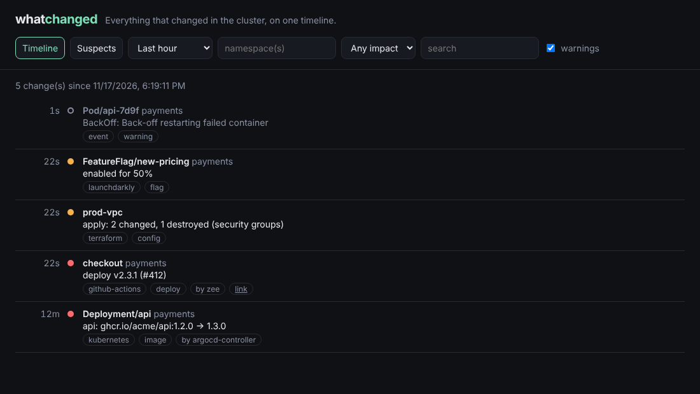

# whatchanged

**The first question in every incident is "what changed?". `whatchanged` answers it in one command.**

It runs in your cluster, watches everything that tends to break things (rollouts, ConfigMaps, Helm releases, GitOps syncs, network policies, node churn), accepts changes pushed from CI, Terraform and feature-flag tools, and puts it all on **one timeline**. When something breaks, it **ranks the likely culprits** and tells you why.

```console
$ whatchanged suspects -n payments
Most likely culprits for a problem at 19:22 Tue 17 Nov (1h0m0s window, 3 warning event(s)):

SCORE  AGE  IMPACT  SOURCE        NAMESPACE  OBJECT                   CHANGE
90     9m   high    kubernetes    payments   Deployment/api           api: ghcr.io/acme/api:1.2.0 → 1.3.0
50     4m   medium  launchdarkly  payments   FeatureFlag/new-pricing  enabled for 50%
36     6m   medium  terraform     -          prod-vpc                 apply: 2 changed, 1 destroyed (security groups)
8      20m  medium  kubernetes    cache      ConfigMap/redis-config   data keys changed maxmemory

#1 Deployment/api: high impact image, 9m before, same namespace, followed by 3 warning(s): BackOff, OOMKilling
#2 FeatureFlag/new-pricing: medium impact flag, 4m before, same namespace
#3 prod-vpc: medium impact config, 6m before, cluster-wide
```



- **Zero dependencies.** Pure Go standard library: no client-go, no database. One ~7 MB static binary.
- **Read-only.** It only ever `list`s and `watch`es. Secret values are never stored, and Helm releases are read as metadata only.
- **Explainable.** Every suspect score comes with its reasons. No ML black box.
- **Small footprint.** 20m CPU and 64Mi memory requested.

## What it tracks

| Tracker | What you see | Default |
|---|---|---|
| `deployments`, `statefulsets`, `daemonsets` | image changes (`api: repo:1.2 → 1.3`), *which* template fields changed (`containers[api].env`, `pod.tolerations`…), rollout restarts, scaling, pause/resume, create/delete | on |
| `configmaps` | which keys changed, were added or removed | on |
| `helm-releases` | installs, upgrades, rollbacks and failures, backfilled on start from Helm's release history | on |
| `argocd-applications` | syncs (`synced 3f9a1c2e → 8d0b77aa`), apps going Degraded | on if the CRD exists |
| `flux-kustomizations`, `flux-helmreleases` | applied revision changes, Ready=False | on if the CRD exists |
| `networkpolicies` | policy created / rules changed / deleted | on |
| `cilium-networkpolicies`, `cilium-clusterwidenetworkpolicies` | same, for Cilium (CNP and CCNP) | on if the CRD exists |
| `nodes` | joins, removals, cordons, NotReady, kubelet upgrades | on |
| `warning-events` | `BackOff`, `OOMKilling`, `FailedScheduling`… recorded as *signals*. They're evidence for suspects, never suspects themselves | on |
| `secrets` | which keys changed (values are hashed in memory, never stored) | **opt-in** |
| **push API** | anything else: CI deploys, Terraform applies, feature flags, DB migrations, vendor incidents | when a token is set |

Each change records an **actor**: the Kubernetes field manager that last touched the object (`kubectl-edit`, `argocd-controller`, `helm`, `kustomize-controller`…). That's often enough to tell a human hotfix from a GitOps rollout.

## Install

```bash
git clone https://github.com/simplyzee/whatchanged
helm install whatchanged ./whatchanged/deploy/helm/whatchanged \
  -n whatchanged --create-namespace \
  --set persistence.enabled=true
```

Then open the UI:

```bash
kubectl -n whatchanged port-forward svc/whatchanged 8080
open http://localhost:8080
```

### CLI

```bash
go install github.com/simplyzee/whatchanged/cmd/whatchanged@latest
# or grab a binary from the GitHub releases page
```

The CLI talks to the server's API (`WHATCHANGED_URL`, default `http://localhost:8080`, which works with the port-forward above).

```bash
whatchanged                          # last hour, everything
whatchanged --since 30m -n payments  # one namespace
whatchanged --impact high -o wide    # only the scary stuff, with actor and timestamp
whatchanged --source helm,argocd     # just releases and syncs
whatchanged -q redis                 # free-text search
whatchanged suspects -n payments     # what probably broke payments just now?
whatchanged suspects --at 2026-11-17T14:05:00Z --window 2h   # …or at 14:05
whatchanged -o json | jq             # scriptable
```

## Pushing changes from outside the cluster

Half of all "what changed" answers live outside Kubernetes. Push them in:

```bash
export WHATCHANGED_URL=https://whatchanged.internal WHATCHANGED_TOKEN=...

whatchanged push --source terraform --name prod-vpc --action config --impact high \
  --summary "apply: 2 changed, 1 destroyed"

whatchanged push --source launchdarkly --kind FeatureFlag --name new-pricing \
  -n payments --action flag --summary "enabled for 50%"
```

Or with plain HTTP:

```bash
curl -X POST "$WHATCHANGED_URL/api/v1/changes" \
  -H "Authorization: Bearer $WHATCHANGED_TOKEN" \
  -d '{"source":"github-actions","name":"checkout","namespace":"payments",
       "summary":"deploy v2.3.1","impact":"high","actor":"zee",
       "url":"https://github.com/acme/checkout/actions/runs/123"}'
```

The chart generates the token for you:

```bash
kubectl -n whatchanged get secret whatchanged-ingest -o jsonpath='{.data.token}' | base64 -d
```

See [`examples/`](examples/) for a GitHub Actions step and a Terraform wrapper. Pushes are idempotent: the same change sent twice is stored once.

## Grafana

**Annotations on every dashboard (push):** give whatchanged a Grafana service-account token and every medium- or high-impact change shows up as an annotation on your existing panels.

```bash
kubectl -n whatchanged create secret generic grafana-token --from-literal=token=glsa_...
helm upgrade whatchanged ./deploy/helm/whatchanged -n whatchanged --reuse-values \
  --set grafana.url=http://grafana.monitoring.svc \
  --set grafana.existingSecret=grafana-token \
  --set clusterName=prod-eu-west-1
```

Annotations are tagged `whatchanged`, the source, the action, the impact, `ns:<namespace>` and `cluster:<name>`, so you can filter them per dashboard.

**Query on demand (pull):** with the Infinity datasource, add an annotation query against
`http://whatchanged.whatchanged:8080/api/v1/grafana/annotations?from=${__from}&to=${__to}&namespace=payments`.

## How suspects are ranked

For a problem starting at time **T**, every change in the window before T gets a score from 0 to 100:

1. **Impact.** Image changes, Helm releases, GitOps syncs, network policy changes and NotReady nodes are *high*. Config and template changes, restarts and cordons are *medium*. Scaling and new ConfigMaps are *low*.
2. **Recency.** The score halves every quarter of the window. Older changes keep a small floor because slow burns happen.
3. **Locality.** If you pass `-n`, changes in that namespace count fully, cluster-wide changes (nodes, CCNPs, Terraform) count 80%, and other namespaces count 35%.
4. **Evidence.** Warning events in the same namespace within 15 minutes *after* a change boost it, e.g. `followed by 3 warning(s): BackOff, OOMKilling`.

It's a heuristic, not an oracle. It's built to give you the right first three things to look at.

## API

| Endpoint | |
|---|---|
| `GET /api/v1/changes` | `since`, `until` (`30m`, `2h`, `1d`, RFC 3339 or unix ms), `namespace`, `kind`, `source`, `action` (comma-separated), `impact` (minimum), `q`, `signals=false`, `limit` |
| `GET /api/v1/suspects` | `at`, `window`, `namespace`, `limit` |
| `POST /api/v1/changes` | Bearer token. One change or an array of up to 100. Fields: `source` (required), `name`, `summary`, `namespace`, `kind`, `action`, `impact`, `actor`, `url`, `labels`, `time` |
| `GET /api/v1/grafana/annotations` | `from`, `to` (ms), plus the `changes` filters |
| `GET /api/v1/status` | tracker states (`synced`, `not-installed`, `forbidden`), store size |
| `GET /metrics` | Prometheus metrics: `whatchanged_changes_total{source,action}`, `whatchanged_changes_stored`, `whatchanged_trackers_synced`, … |
| `GET /healthz`, `GET /readyz` | ready once every tracker has finished its first list |

## Configuration

`whatchanged server -h` lists every flag. The important ones:

| Flag | Default | |
|---|---|---|
| `--data-dir` | *(memory)* | persist to `changes.jsonl` (append-only, compacted on retention) |
| `--retention` | `7d` | |
| `--enable` / `--disable` | | tracker names, comma separated (`whatchanged trackers` lists them) |
| `--exclude-namespaces` | `kube-node-lease` | |
| `--ingest-token-file` | | or `WHATCHANGED_INGEST_TOKEN`. The push API is disabled without a token |
| `--grafana-url`, `--grafana-token-file`, `--grafana-min-impact` | | |
| `--api-server` | in-cluster | for local dev: `kubectl proxy` then `--api-server http://127.0.0.1:8001` |
| `--no-kubernetes` | | push API only, no cluster watching |

## Running locally

```bash
make dev   # starts kubectl proxy and runs the server against your current context
```

Without a cluster:

```bash
WHATCHANGED_INGEST_TOKEN=dev go run ./cmd/whatchanged server --no-kubernetes --log-format text
```

## Design notes

- **No client-go.** A ~450-line list/watch client handles pagination, bookmarks, `410 Gone` relists and backoff. The dependency graph is empty, so builds are fast and supply-chain review is trivial.
- **Diff, don't log.** Each tracker keeps a tiny fingerprint per object (image map, per-field hashes, per-key hashes) and diffs it. That's how it can say *which* env block or ConfigMap key changed without storing any contents.
- **Relists are diffs too.** If a watch expires, the relist is compared against known state, so changes during the gap aren't lost.
- **Deterministic IDs.** Every change has a content-derived ID, so restarts, relists and Helm or Argo backfills never create duplicates.
- **Single replica by design.** The store is a single-writer append-only log. Keep `replicaCount: 1`, because changes are cheap to re-derive.

## Roadmap

- Ingress / Service / HPA / CronJob trackers
- Native webhooks for GitHub deployments, ArgoCD notifications and Terraform Cloud run notifications
- `kubectl whatchanged` plugin
- Alertmanager integration: attach top suspects to firing alerts
- Multi-cluster: point several clusters at one central store

## Contributing

Issues and PRs welcome. `make lint test` must pass. The end-to-end tests run against a fake API server (`internal/kube/kubetest`), and CI also installs the chart into a kind cluster and checks real changes are recorded.

## License

Apache 2.0
